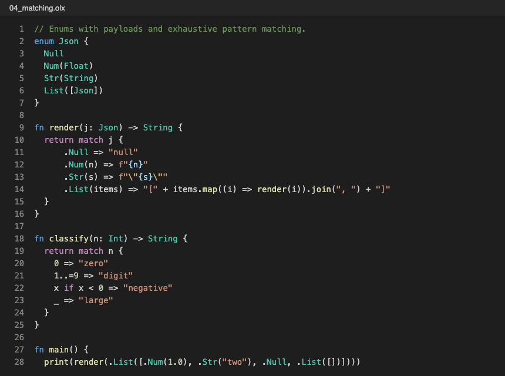

# Mycel for VS Code

Language support for [Mycel](https://ol1x.xyz/mycel) (`.myc` and `.olx` files).

*Highlighting produced by this extension's grammar, rendered headlessly with VS Code's Dark+ colours.*

## What you get

- **Syntax highlighting**: keywords, types, declarations, numbers, comments, and f-strings with `{expr}` interpolation, `{{` / `}}` literal braces and format specs.
- **Errors and warnings as you type**, with the same messages, explanations (`why`) and suggested fixes that `mycel check` prints.
- **Hover** shows the type of the name under the cursor, **Go to Definition**, **completion** (names, members after a `.`, keywords) and a document **outline**.
- **Run**: press <kbd>Cmd</kbd>+<kbd>Enter</kbd> (<kbd>Ctrl</kbd>+<kbd>Enter</kbd> elsewhere) or use the play button to run the current file with `mycel file.myc` in a terminal.
- Snippets: `fn`, `class`, `struct`, `enum`, `match`, `for`, `test`.
- Brackets, auto-closing pairs and `//` / `/* */` commenting.

## Requirements

The language features and Run call the `mycel` command, so Mycel must be installed. If `mycel` is not on your `PATH`, set
**`mycel.path`** to its full path. Without it the extension still gives you highlighting, snippets and bracket handling,
and tells you once that the language server could not start.

The language server is `mycel lsp` (stdio). The command **Mycel: Restart Language Server** restarts it.

## Settings

| Setting | Default | |
|---|---|---|
| `mycel.path` | `mycel` | Path to the `mycel` executable. |

## Links

[ol1x.xyz/mycel](https://ol1x.xyz/mycel)
